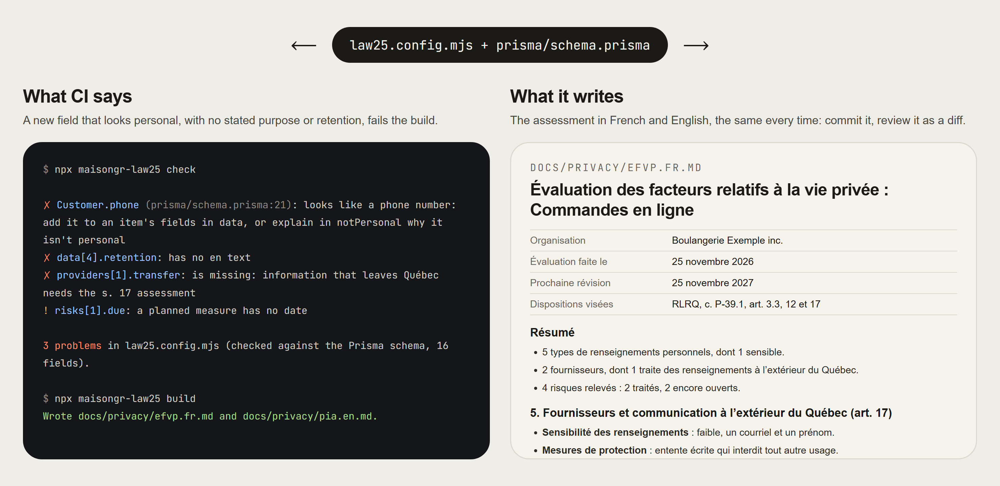

# maisongr-law25

**Your Law 25 privacy impact assessment, next to your code.** Describe the personal information your app handles in one file; `check` fails CI when the schema stores a field that looks personal and that the assessment doesn't account for, and `build` writes the assessment in French and English.

[](https://www.npmjs.com/package/maisongr-law25)
[](https://github.com/maison-gr/maisongr-law25/actions/workflows/ci.yml)
[](LICENSE)




```sh
npx maisongr-law25 init     # law25.config.mjs, started from your Prisma schema or SQL migrations
npx maisongr-law25 check    # every required entry written, every field that looks personal accounted for? exit 1 if not
npx maisongr-law25 build    # docs/privacy/efvp.fr.md and docs/privacy/pia.en.md
```

```text
✗ Customer.phone (prisma/schema.prisma:21): looks like a phone number: add it to an item's fields in data, or explain in notPersonal why it isn't personal
1 problem in law25.config.mjs (checked against the Prisma schema (prisma/schema.prisma), 16 fields).
```

> This package helps you write and maintain an assessment. It is not legal advice, and it does not determine whether an assessment is required or sufficient: have it reviewed by a qualified advisor. Provided as is, without warranty (see [LICENSE](LICENSE)). The legislation prevails.

## Why

Québec's *Act respecting the protection of personal information in the private sector* (CQLR c. P-39.1), as amended by Law 25, requires a privacy impact assessment for any project to acquire, develop or overhaul an information system or electronic service delivery system involving the collection, use, communication, keeping or destruction of personal information (s. 3.3), and before personal information is communicated outside Québec, or someone outside Québec is entrusted with it (s. 17). Most apps do both: a database, an email provider, a hosting region. Outside Québec includes the rest of Canada.

The assessment is usually a document written once. Then the code moves on: a new column, a new provider, a field nobody remembers adding. This package keeps the assessment in the repository, beside the schema it describes, and makes CI say when they drift apart.

## How `check` works

1. It reads your schema: a Prisma schema (`prisma/schema.prisma`, or a folder of `.prisma` files), or your SQL migrations in order (`supabase/migrations`, `migrations`, `db/migrations`…), following `CREATE TABLE`, `ADD COLUMN`, `DROP COLUMN` and `DROP TABLE` in PostgreSQL, MySQL, SQLite and SQL Server syntax. Any stack works through SQL: point `--sql` at a schema dump (`pg_dump --schema-only`, `mysqldump --no-data`, `rails db:schema:dump` with `structure.sql`) or at migrations written in SQL (Flyway, dbmate, golang-migrate, Supabase).
2. It flags every field that looks like personal information: by name (`email`, `phone`, `dateOfBirth`, `ipAddress`, `lastName`, `gender`…, and `name`, `city` or `location` on a table about people), or because a comment marks it `@personal`.
3. Each flagged field must be listed in an item's `fields`, or explained in `notPersonal`. A field in the assessment that the schema no longer has is an error too.
4. The assessment must be complete: every purpose and retention period written (in each language), no `TODO` left, a s. 17 assessment for every provider outside Québec, the next review date not past.

Mark what the names don't tell:

```prisma
model Customer {
  /// Allergies the customer chooses to tell us.
  /// @personal
  allergies String?
  /// @not-personal
  shopNote  String?
}
```

```sql
create table profiles (
  id uuid primary key,
  bio text, -- @personal
  theme text -- @not-personal
);
```

## The assessment

`law25.config.mjs` (or `.js`, or `.json`). Every text is one string for every language, or `{ fr: "…", en: "…" }`; `check` makes sure each language is written. The [example](example/law25.config.mjs) is a complete one, for a fictional bakery's ordering app, and its reports are [in French](example/docs/privacy/efvp.fr.md) and [in English](example/docs/privacy/pia.en.md).

```js
/** @type {import("maisongr-law25").Assessment} */
export default {
  languages: ["fr", "en"],
  organisation: {
    name: "Boulangerie Exemple inc.",
    privacyOfficer: { title: { fr: "Propriétaire", en: "Owner" }, contact: "vieprivee@boulangerie-exemple.ca" },
  },
  project: { name: "…", description: "…", objectives: ["…"], proportionality: "…" },
  assessed: "2026-11-25",
  nextReview: "2027-11-25",
  data: [
    {
      name: { fr: "Courriel", en: "Email" },
      fields: ["Customer.email"],
      whose: { fr: "Clients", en: "Customers" },
      source: "person",
      purpose: { fr: "Confirmer la commande et se connecter.", en: "Confirm the order and sign in." },
      retention: { fr: "Tant que le compte existe, puis 30 jours.", en: "While the account exists, then 30 days." },
      storedIn: "PostgreSQL (Canada, Montréal)",
      access: { fr: "Le client; l’équipe", en: "The customer; the team" },
    },
  ],
  providers: [
    {
      name: "Email provider", service: "Order emails", data: ["Email"],
      location: "United States", outsideQuebec: true, safeguards: "Processing agreement",
      transfer: { sensitivity: "…", purposes: "…", protection: "…", legalFramework: "…", conclusion: "…" },
    },
  ],
  risks: [
    { stage: "retention", risk: "Inactive accounts stay forever", measure: "Deleted after three years", status: "planned", owner: "Dev", due: "2027-01-15" },
  ],
};
```

| Field | What it holds |
|---|---|
| `languages` | `["fr", "en"]` (default), `["fr"]` or `["en"]` |
| `organisation` | `name`, and `privacyOfficer` (`title`, `contact`): the person in charge of the protection of personal information (s. 3.1) |
| `project` | `name`, `description`, `objectives` (why personal information is needed), `proportionality` (why it's no more than needed) |
| `assessed`, `nextReview` | ISO dates; `check` fails once `nextReview` has passed |
| `officerConsulted`, `portability` | When the person in charge was consulted, from the project's outset, and how a person gets their computerized information back in a structured, commonly used format (s. 3.3; optional) |
| `roles`, `consultations` | Who took part, and who was consulted (optional) |
| `data[]` | `name`, `fields` (`Model.field` or `table.column`), `whose`, `source` (`person`, `third-party`, `generated`, `public`), `purpose`, `retention`, `storedIn`, `access`, `sensitive` (why, when s. 12 applies) |
| `providers[]` | `name`, `service`, `data` (item names), `location`, `outsideQuebec` (the rest of Canada counts, and so do subcontractors and where the data is reached from), `safeguards`, and `transfer` (the factors s. 17 names: `sensitivity`, `purposes`, `protection`, `legalFramework`, and a `conclusion` on adequate protection and the written agreement) |
| `risks[]` | `stage` (`collection`, `use`, `communication`, `retention`, `other`), `risk`, `measure`, `status` (`done`, `planned`, `to-confirm`), `owner`, `due` |
| `approvals[]`, `updates[]` | Who approved it and when; what changed and when |
| `notPersonal` | `{ "Post.authorName": "a pen name the user chooses to publish" }` |

With the package installed (`npm install --save-dev maisongr-law25`), the `@type` comment gives autocompletion and type checks in your editor; `npx` needs nothing installed.

## The report

`build` writes one Markdown file per language, the same every time for the same config, so it can be committed and reviewed as a diff:

1. The project: description, objectives, proportionality
2. Roles and consultations
3. Personal information: whose, where from, why, how long, where, who sees it, and the fields in the code
4. Sensitive information (s. 12)
5. Providers and communication outside Québec (s. 17), with the factors s. 17 names for each provider outside Québec
6. Risks and measures, by stage: collection, use, communication, retention and destruction
7. Action plan: the open measures, by due date
8. Approval and history

The sections cover the points ss. 3.3, 12 and 17 name, and the topics the [Commission d'accès à l'information's guide](https://www.cai.gouv.qc.ca/commission-acces-information/guide-fiches-information) walks through. The wording is this package's own: it doesn't reproduce the Commission's template. The French is written for Québec, with its typography.

## In CI

```yaml
- run: npx maisongr-law25 check
```

A pull request that adds `users.phone` without saying why it's collected and how long it's kept fails, with the file and line of the new field.

Options: `--config <file>`, `--prisma <path>`, `--sql <path>`, `--no-schema` (check the assessment alone), `--out <folder>` and `--lang fr|en` for `build`, `--json` for a machine-readable result. Exit codes: 0 done, 1 problems found, 2 a usage error.

## In code

```js
import { validate, render, parsePrisma, parseSql, looksPersonal } from "maisongr-law25";

const problems = validate(assessment, parsePrisma(schemaText), "2026-11-25");
const markdown = render(assessment, "fr");
```

## For AI agents

The package ships an [Agent Skill](skills/maisongr-law25/SKILL.md) and an [`llms.txt`](llms.txt). An agent that adds a column holding personal information can run `check`, then add the item, with its purpose and retention, for a person to confirm.

## Limits

- Personal fields are found by name and by marker. A free-text field (`notes`, `message`) can hold personal information under any name: mark it `@personal`.
- It reads Prisma and SQL migrations. Drizzle, TypeORM, Mongoose and others aren't read yet: use `--no-schema`, and list `fields` by hand.
- It checks that the assessment is complete and matches the schema, not that what it says is true or sufficient. That is the assessment's job, and the advisor's.
- It doesn't decide whether an assessment is required, or whether it is enough.
- It covers the privacy impact assessment of the private sector Act. Public bodies fall under a different Act (CQLR c. A-2.1), and other assessments (such as for communication for research purposes) aren't covered.
- Law 25's other duties (the published policy, consent, the confidentiality incident register, the person in charge's contact on your site) are yours to meet.
- Section numbers refer to CQLR c. P-39.1 as in force on the release date; check the current text on [LégisQuébec](https://www.legisquebec.gouv.qc.ca/en/document/cs/P-39.1).

## Requirements

Node.js 20.9 or later, on Linux, macOS and Windows. No runtime dependencies. An ES module: from CommonJS, `require("maisongr-law25")` works on Node 22.12 and later; on Node 20, use `await import("maisongr-law25")`. The CLI works the same everywhere, in any project: it needs nothing installed beside it, whatever the project's language.

## More from Maison GR

Open source from [Maison GR](https://www.maisongr.com), a software studio in Québec City:

- [maisongr-sitemap](https://github.com/maison-gr/maisongr-sitemap): one sitemap, two readers. The XML search engines need, and a page in your site's own design for people.
- [Maison GR Sitemap for WordPress](https://github.com/maison-gr/maisongr-sitemap-wordpress): the same sitemap for WordPress, in your theme's colours and type.
- [maisongr-skills](https://github.com/maison-gr/maisongr-skills): one engineering standard for every AI coding agent: Claude Code, Codex, Cursor, Copilot, Gemini CLI.
- [maisongr-typo](https://github.com/maison-gr/maisongr-typo): French typography, the Québec way, with a CI check.

## License

MIT, © Maison GR Inc. Not affiliated with or endorsed by the Commission d'accès à l'information.
